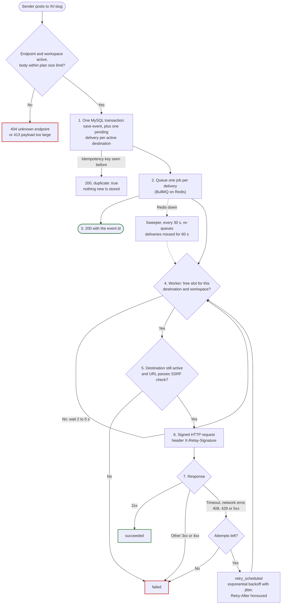
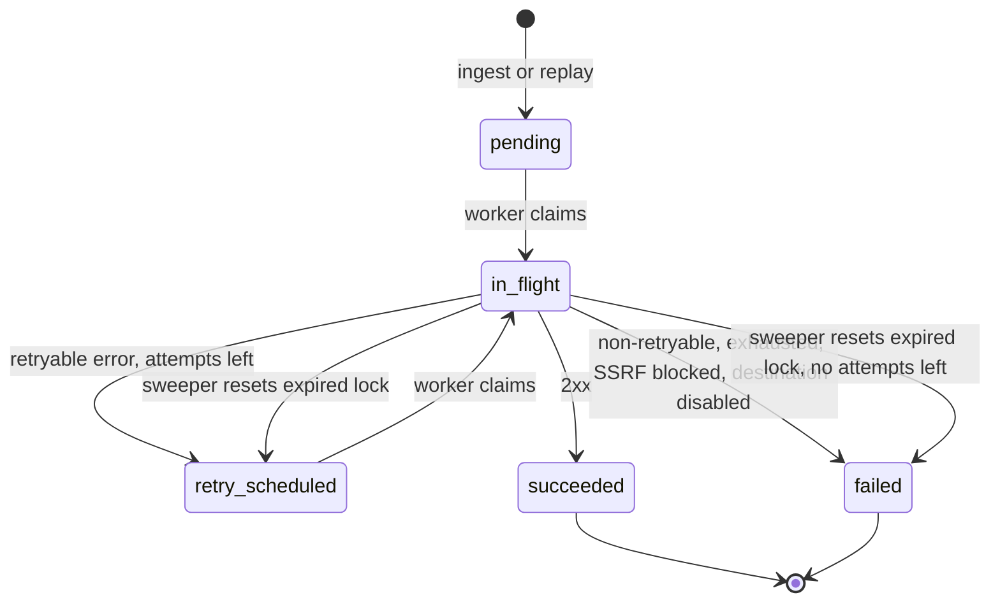

<div align="center">

# RELAY Backend

**A hosted, multi-tenant webhook gateway.**
Store every event byte-exact first. Deliver it later, signed, retried and replayable.

[](https://github.com/parthgupta21/relay-backend/actions/workflows/ci.yml)
[](https://nodejs.org)
[](https://koajs.com)
[](https://www.mysql.com)
[](https://redis.io)
[](https://bullmq.io)
[](https://socket.io)

</div>

---

## Contents

- [Why RELAY](#why-relay)
- [Features](#features)
- [Architecture](#architecture)
- [Tech stack](#tech-stack)
- [Project structure](#project-structure)
- [Quick start](#quick-start)
- [Configuration](#configuration)
- [API reference](#api-reference)
- [Verifying signatures](#verifying-signatures)
- [Reliability](#reliability)
- [Security](#security)
- [Testing](#testing)
- [Roadmap](#roadmap)
- [Related](#related)
- [License](#license)

## Why RELAY

Webhook senders post once and move on. If your server is down, slow or deploying, the event is at the mercy of the sender's retry policy. Those policies differ, and none of them gives you a way to see what arrived or to replay it safely.

| Sender  | Retry behavior                                                                    | What goes wrong                                                                                  |
| ------- | --------------------------------------------------------------------------------- | ------------------------------------------------------------------------------------------------ |
| Stripe  | Retries for up to 3 days in live mode.                                            | Events can still be missed after the window, and you cannot inspect or replay on your own terms. |
| GitHub  | No automatic retry. Manual redelivery is allowed within 3 days.                   | A deploy gap loses the event unless someone redelivers by hand.                                  |
| Shopify | 5 second timeout, 8 retries over about 4 hours, then the subscription is removed. | A slow handler or a long outage can remove the webhook subscription itself.                      |

RELAY sits in front of your server. Senders post to a stable RELAY URL and get a fast response. RELAY stores the request first, then a separate worker delivers it to your destinations. Your server can be down, slow or redeploying without losing the event.

## Features

**Capture**

- Stable public ingest URL per endpoint: `/h/:slug`, any HTTP method, any sub-path.
- Body stored as raw bytes, byte-exact, so sender signatures still verify downstream.
- Optional per-endpoint idempotency header (for example `x-github-delivery`). Repeats are captured once and answered with `duplicate: true`.
- Per-workspace body size limit, with `413` above it.

**Delivery**

- A separate worker process delivers each event to every active destination.
- HMAC-SHA256 signed requests with a per-destination signing secret.
- Retries with exponential backoff and equal jitter. `Retry-After` is honoured on `429` and `503`.
- Per-destination and per-workspace concurrency caps.
- Sweeper that recovers stuck and missed deliveries.
- Per-delivery attempt history: outcome, status, duration, error, response headers and body (first 64 KB).

**Replay**

- Replay one delivery or one event to chosen destinations.
- `Idempotency-Key` required on replay. Retried requests return the stored response.
- Hourly replay quota per workspace.

**Safety and operations**

- SSRF protection on destination URLs, checked on create and again at send time.
- Signing secrets encrypted at rest with AES-256-GCM.
- Retention purge per workspace.
- Live updates over Socket.IO: `event.created` and `delivery.updated`.
- Tenant isolation: records outside your workspace return `404`.

## Architecture

### How a webhook flows through RELAY



1. Ingest stores the raw event and creates one `pending` delivery per active destination, in one transaction (`routes/ingest.js`).
2. After the commit, each delivery is queued as a BullMQ job. If Redis is down, the sender still gets `200`. The sweeper queues the delivery later.
3. The sender gets `200` with the event id. Delivery happens after this, so a slow destination never slows the sender.
4. The worker takes a concurrency slot for the destination and the workspace. If none is free, the job waits 2 to 5 seconds and tries again (`services/semaphore.js`).
5. The worker marks the delivery `in_flight`, then checks that the destination is still active and that its URL resolves to a public address. Otherwise the delivery fails with `destination_disabled` or `ssrf_blocked`.
6. The request is signed with HMAC-SHA256 (`services/outbound.js`).
7. A 2xx response means `succeeded`. A retryable error schedules another attempt until `maxAttempts` runs out. Any other response fails at once. The attempt and the new status are saved in one transaction (`services/delivery.js`).

Every status change is pushed to the web app as a `delivery.updated` Socket.IO event.

`ROLE=ingest|app|all` (default `all`) chooses what one API process mounts. `ingest` mounts only `/h/*`. `app` mounts only `/api/v1` and Socket.IO. The worker always runs as its own process.

### Delivery states



Failure reasons stored on `failed`: `non_retryable`, `exhausted`, `ssrf_blocked`, `destination_disabled`.

### Design decisions

| Decision                                                                                                                                           | Why                                                                                                                        | Trade-off                                                                                                                                                 |
| -------------------------------------------------------------------------------------------------------------------------------------------------- | -------------------------------------------------------------------------------------------------------------------------- | --------------------------------------------------------------------------------------------------------------------------------------------------------- |
| Store the event in MySQL before any delivery work. Insert event and deliveries in one transaction.                                                 | The sender gets an answer after a durable write, and nothing depends on Redis being up.                                    | Ingest does a database write per request.                                                                                                                 |
| `addBulk` after commit, with deterministic job IDs `d{id}-a{n}`.                                                                                   | BullMQ drops duplicate job IDs, so ingest, retry, sweeper and replay can all share one enqueue path and re-adding is safe. | The database row is the source of truth. The queue is only a trigger.                                                                                     |
| Producer Redis connection with `enableOfflineQueue: false`, plus a `status === "ready"` check in ingest.                                           | Without it, `addBulk` waits forever when Redis is down and ingest hangs (verified).                                        | If Redis is down, ingest returns 200 and logs `enqueue skipped`. Deliveries wait for the sweeper, so recovery takes 60 to 90 seconds after Redis returns. |
| Worker claims with a conditional `UPDATE`.                                                                                                         | Two workers cannot run the same attempt.                                                                                   | One extra write per attempt.                                                                                                                              |
| Attempt row and delivery update in one transaction after the HTTP call.                                                                            | The history never disagrees with the delivery status.                                                                      | If the worker dies mid-call, only the sweeper recovers it.                                                                                                |
| Concurrency caps as Redis sorted sets with a Lua script. Key `sem:dst:{id}` and `sem:ws:{id}`, member is the job ID, score is expiry (now + 60 s). | One script prunes expired members and adds to both sets or neither. A crashed worker's slot expires by itself.             | Slots are not renewed. A refused job is moved to delayed for 2 to 5 seconds with no cap on how often.                                                     |
| Sweeper and retention run on `setInterval` in the worker, not BullMQ repeatable jobs.                                                              | Both are idempotent, so every replica can run them. No scheduler state in Redis.                                           | With N workers, each runs the sweep, which costs more database reads.                                                                                     |
| Idempotency keys in Redis (`idem:{workspaceId}:{key}`, 24 h TTL), reserved with `SET NX`.                                                          | No migration, and TTL expiry is built in.                                                                                  | Keys are not purged by retention. The fingerprint uses the parsed JSON body, so key order matters.                                                        |
| Realtime events go through Redis pub/sub, then Socket.IO.                                                                                          | The worker publishes `delivery.updated` and any API replica forwards it to the right workspace room.                       | Pub/sub is fire-and-forget. A client that is disconnected misses the push.                                                                                |
| SSRF allows only addresses that `ipaddr.js` ranges as `unicast`.                                                                                   | Stricter than a blocklist: tunnel and benchmarking ranges are blocked too. IPv4-mapped IPv6 is converted first.            | Some unusual but legitimate destination addresses are rejected.                                                                                           |
| Signing secrets encrypted with AES-256-GCM. Stored as iv(12) + tag(16) + ciphertext.                                                               | The worker must read the secret to sign, so it cannot be hashed.                                                           | Losing `RELAY_ENCRYPTION_KEY` makes all secrets unreadable.                                                                                               |
| Sequelize with sequelize-cli, CommonJS, `node:test` and supertest. Layout follows the author's existing service structure.                         | Consistent with the work codebase this project mirrors.                                                                    | Heavier than a query builder.                                                                                                                             |
| Console logging with a `cls-hooked` request context instead of a logging library.                                                                  | Every line carries `requestId`, method and URL without passing context around. Ingest slugs are masked to 6 characters.    | No structured JSON output yet.                                                                                                                            |

## Tech stack

| Layer                  | Choice                                       | Why                                                                                                                                                                                   |
| ---------------------- | -------------------------------------------- | ------------------------------------------------------------------------------------------------------------------------------------------------------------------------------------- |
| Runtime                | Node.js 22 (see `Dockerfile`), CommonJS      | Matches the container image.                                                                                                                                                          |
| HTTP                   | Koa 3 with `@koa/router` 15                  | Small core, async middleware.                                                                                                                                                         |
| Database               | MySQL 8.4 with Sequelize 6 and sequelize-cli | Durable event store and migrations.                                                                                                                                                   |
| Queue and coordination | Redis 7 with BullMQ 6 and ioredis 6          | Delayed jobs for retries, plus semaphores, idempotency keys, quota counters and pub/sub. ioredis is installed explicitly because BullMQ lists it only as an optional peer dependency. |
| Realtime               | Socket.IO 4                                  | Cookie-authenticated pushes to a workspace room.                                                                                                                                      |
| Validation             | zod 4                                        | Request bodies, params and query.                                                                                                                                                     |
| Passwords              | argon2                                       | Memory-hard hashing.                                                                                                                                                                  |
| Raw body               | raw-body 4                                   | Reads the ingest body as bytes.                                                                                                                                                       |
| IP checks              | ipaddr.js                                    | SSRF range classification.                                                                                                                                                            |
| Email                  | nodemailer, Mailpit locally                  | Verification and reset mail, sent inline.                                                                                                                                             |
| IDs                    | ulid                                         | Prefixed public IDs (`dlv_...`, `ws_...`).                                                                                                                                            |
| Tests                  | `node:test`, supertest, socket.io-client     | Real MySQL, Redis and Mailpit. No mocks of the stores.                                                                                                                                |

## Project structure

```text
.
├── index.js              # Koa app: health, /api/v1, ingest, Socket.IO attach
├── worker.js             # BullMQ worker, sweeper and retention timers
├── logging.js            # console wrapper with request context
├── namespace.js          # cls-hooked namespace
├── config/config.js      # Sequelize CLI config (development, test, production)
├── database/index.js     # Sequelize instance
├── docker/init.sql       # Creates relay and relay_test databases
├── docker-compose.yml    # MySQL, Redis, Mailpit for local development
├── Dockerfile            # node:22-slim, runs index.js as USER node
├── migrations/           # 10 migrations: users to delivery_attempts
├── models/               # user, workspace, session, emailToken, endpoint, event,
│                         # destination, delivery, deliveryAttempt, auditLog
├── routes/
│   ├── auth.js           # /api/v1/auth/*
│   ├── endpoints.js      # /api/v1/endpoints/*
│   ├── events.js         # events, event body, event replay
│   ├── destinations.js   # destinations and secret rotation
│   ├── deliveries.js     # delivery detail and replay
│   └── ingest.js         # /h/:slug{/*rest}
├── middleware/
│   ├── auth.js           # relay_sid cookie to session
│   ├── originCheck.js    # Origin check on POST, PATCH, DELETE
│   ├── requireVerified.js
│   ├── idempotency.js    # Idempotency-Key handling in Redis
│   ├── validate.js       # zod validation
│   └── errorHandler.js   # error envelope
├── services/
│   ├── delivery.js       # processJob: claim, send, classify, retry
│   ├── outbound.js       # signed HTTP send
│   ├── ssrf.js           # address checks, pinned lookup
│   ├── queue.js          # BullMQ queue and producer connection
│   ├── semaphore.js      # Redis concurrency caps
│   ├── sweeper.js        # stuck and missed deliveries
│   ├── replay.js         # delivery and event replay
│   ├── retention.js      # purge expired events
│   ├── realtime.js       # Redis pub/sub and Socket.IO
│   └── email.js
├── utils/                # AppError, IDs, backoff, helpers
└── test/                 # node:test suites, receiver and helpers
```

## Quick start

Prerequisites: Node.js 22, Docker.

```bash
docker compose up -d      # MySQL on 3307, Redis on 6379, Mailpit SMTP 1025, UI http://localhost:8025
cp .env.example .env
npm install
npm run migrate           # dev database "relay"
npm run migrate:test      # test database "relay_test"
```

Run the API and the worker in two terminals. No app containers are used locally. Compose runs only MySQL, Redis and Mailpit.

```bash
npm start                 # API and ingest on :3000 (ROLE=ingest|app|all, default all)
npm run worker            # delivery worker, sweeper, retention
```

Run the tests:

```bash
npm test
```

To use the web app, start [relay-frontend](https://github.com/parthgupta21/relay-frontend). It runs on `http://localhost:5173` and proxies `/api`, `/h` and `/socket.io` to this server. `APP_BASE_URL` in `.env.example` already points at it.

Verification and reset emails appear in Mailpit at `http://localhost:8025`.

## Configuration

Settings in `.env.example`:

| Variable                     | Default in `.env.example`      | Purpose                                                                                                               |
| ---------------------------- | ------------------------------ | --------------------------------------------------------------------------------------------------------------------- |
| `NODE_ENV`                   | `development`                  | Environment. `production` makes the session cookie `Secure` and forbids `SSRF_ALLOWLIST`.                             |
| `ROLE`                       | `all`                          | `ingest`, `app` or `all`.                                                                                             |
| `PORT`                       | `3000`                         | HTTP port.                                                                                                            |
| `TRUST_PROXY`                | `false`                        | Set `true` behind a trusted proxy so `ctx.ip` uses forwarded headers.                                                 |
| `APP_BASE_URL`               | `http://localhost:5173`        | Web app origin. Used for the CSRF Origin check, Socket.IO origin check and email links.                               |
| `HOOKS_BASE_URL`             | `http://localhost:3000`        | Base URL of the ingest host.                                                                                          |
| `DB_HOST`, `DB_PORT`         | `127.0.0.1`, `3307`            | MySQL address.                                                                                                        |
| `DB_NAME`, `DB_NAME_TEST`    | `relay`, `relay_test`          | Dev and test databases.                                                                                               |
| `DB_USERNAME`, `DB_PASSWORD` | `relay`, `relay`               | MySQL credentials.                                                                                                    |
| `SMTP_HOST`, `SMTP_PORT`     | `127.0.0.1`, `1025`            | Mail server. Mailpit locally.                                                                                         |
| `MAIL_FROM`                  | `RELAY <no-reply@relay.local>` | Sender address.                                                                                                       |
| `MAILPIT_API`                | `http://localhost:8025/api/v1` | Used by tests to read mail.                                                                                           |
| `PLAN_DEFAULTS`              | JSON, see below                | Limits given to a new workspace.                                                                                      |
| `RELAY_ENCRYPTION_KEY`       | sample key                     | 32-byte base64 key for signing secrets. Replace it outside local development.                                         |
| `SSRF_ALLOWLIST`             | `127.0.0.1/32`                 | CIDRs allowed past the SSRF check. Dev and test only. The app throws at load if it is set with `NODE_ENV=production`. |
| `REDIS_URL`                  | `redis://127.0.0.1:6379`       | Redis for BullMQ, semaphores, idempotency and pub/sub.                                                                |
| `DELIVERY_CONCURRENCY`       | `50`                           | Jobs one worker runs at once.                                                                                         |

Default `PLAN_DEFAULTS`:

```json
{
  "maxEndpoints": 5,
  "maxDestinations": 3,
  "maxEventsPerDay": 5000,
  "maxBodyBytes": 524288,
  "retentionDays": 3
}
```

Optional knobs. They are read at use time and are not in `.env.example`:

| Variable                  | Default   | Purpose                               |
| ------------------------- | --------- | ------------------------------------- |
| `RETRY_BASE_MS`           | `30000`   | Base delay for backoff.               |
| `RETRY_CAP_MS`            | `3600000` | Maximum retry delay.                  |
| `DESTINATION_CONCURRENCY` | `5`       | In-flight deliveries per destination. |
| `WORKSPACE_CONCURRENCY`   | `20`      | In-flight deliveries per workspace.   |
| `SWEEPER_INTERVAL_MS`     | `30000`   | Sweeper timer.                        |
| `RETENTION_INTERVAL_MS`   | `3600000` | Retention purge timer.                |

`maxEventsPerDay` is stored on the workspace and returned by `/auth/me`. Nothing enforces it yet. Usage counters and quotas are planned for phase 4.

## API reference

Base path: `/api/v1`. Auth is a `relay_sid` session cookie (HttpOnly, SameSite=Lax, 7 days). `POST`, `PATCH` and `DELETE` also require the `Origin` header, when present, to match `APP_BASE_URL`. JSON bodies are limited to 100 KB.

Auth column: **none** needs no session. **session** needs a logged-in user. **verified** needs a session and a verified email. **idem** also needs an `Idempotency-Key` header (up to 255 characters).

Errors use one envelope:

```json
{
  "error": {
    "code": "NOT_FOUND",
    "message": "Delivery not found",
    "details": [],
    "requestId": "..."
  }
}
```

### Auth

| Method | Path                        | Auth    | Purpose                                                                   |
| ------ | --------------------------- | ------- | ------------------------------------------------------------------------- |
| POST   | `/auth/register`            | none    | Create an account. Always answers `202`, whether or not the email exists. |
| POST   | `/auth/verify-email`        | none    | Consume a verification token.                                             |
| POST   | `/auth/resend-verification` | none    | Send a new verification email. Answers `202`.                             |
| POST   | `/auth/login`               | none    | Start a session and set the cookie.                                       |
| POST   | `/auth/logout`              | session | End the session.                                                          |
| POST   | `/auth/forgot-password`     | none    | Send a reset email. Answers `202`.                                        |
| POST   | `/auth/reset-password`      | none    | Set a new password with a reset token.                                    |
| GET    | `/auth/me`                  | session | Current user, workspace and plan limits.                                  |

### Endpoints

| Method | Path                         | Auth     | Purpose                                                   |
| ------ | ---------------------------- | -------- | --------------------------------------------------------- |
| GET    | `/endpoints`                 | session  | List endpoints.                                           |
| POST   | `/endpoints`                 | verified | Create an endpoint. Checks `maxEndpoints`.                |
| GET    | `/endpoints/:id`             | session  | Get one endpoint.                                         |
| PATCH  | `/endpoints/:id`             | session  | Rename, change the idempotency header, enable or disable. |
| DELETE | `/endpoints/:id`             | session  | Delete an endpoint.                                       |
| POST   | `/endpoints/:id/rotate-slug` | session  | Issue a new ingest slug.                                  |

### Events

| Method | Path                    | Auth           | Purpose                                                                 |
| ------ | ----------------------- | -------------- | ----------------------------------------------------------------------- |
| GET    | `/endpoints/:id/events` | session        | List events. Query: `limit`, `cursor`, `method`. Cursor is opaque.      |
| GET    | `/events/:id`           | session        | Event detail with its deliveries.                                       |
| GET    | `/events/:id/body`      | session        | Download the raw body as an attachment.                                 |
| POST   | `/events/:id/replay`    | verified, idem | Replay to chosen destinations (`destinationIds`). Returns `deliveries`. |

### Destinations

| Method | Path                              | Auth     | Purpose                                                                          |
| ------ | --------------------------------- | -------- | -------------------------------------------------------------------------------- |
| GET    | `/endpoints/:id/destinations`     | session  | List destinations.                                                               |
| POST   | `/endpoints/:id/destinations`     | verified | Create a destination. Returns the signing secret once. Checks `maxDestinations`. |
| PATCH  | `/destinations/:id`               | session  | Update name, URL, timeout, headers or active flag.                               |
| DELETE | `/destinations/:id`               | session  | Soft delete.                                                                     |
| POST   | `/destinations/:id/rotate-secret` | session  | Issue a new signing secret. Returned once.                                       |

### Deliveries

| Method | Path                     | Auth           | Purpose                                  |
| ------ | ------------------------ | -------------- | ---------------------------------------- |
| GET    | `/deliveries/:id`        | session        | Delivery with its attempt history.       |
| POST   | `/deliveries/:id/replay` | verified, idem | Replay one delivery. Returns `delivery`. |

### Ingest and health

| Method | Path                        | Auth | Purpose                                                                                                              |
| ------ | --------------------------- | ---- | -------------------------------------------------------------------------------------------------------------------- |
| ANY    | `/h/:slug` and `/h/:slug/*` | none | Capture a request. Returns `200 { id, duplicate }`. `404` for unknown or disabled slugs, `413` above the body limit. |
| GET    | `/healthz`                  | none | Liveness.                                                                                                            |
| GET    | `/readyz`                   | none | Readiness. Checks MySQL and answers `503` if it is down.                                                             |

### Realtime

Socket.IO on `/socket.io`. The handshake must carry the `relay_sid` cookie and an allowed origin. Each socket joins its workspace room.

| Event              | Payload                           |
| ------------------ | --------------------------------- |
| `event.created`    | `{ endpointId, eventId }`         |
| `delivery.updated` | `{ deliveryId, eventId, status }` |

Sweeper and replay transitions are not pushed yet, so clients should keep polling as a fallback.

## Verifying signatures

Every delivery carries these headers, set in `services/outbound.js`:

| Header                | Value                                   |
| --------------------- | --------------------------------------- |
| `X-Relay-Signature`   | `t=<unix seconds>,v1=<hex HMAC-SHA256>` |
| `X-Relay-Timestamp`   | Unix seconds, same as `t`.              |
| `X-Relay-Event-Id`    | Event public ID.                        |
| `X-Relay-Delivery-Id` | Delivery public ID.                     |
| `X-Relay-Attempt`     | Attempt number.                         |

The signed string is the timestamp, a dot, then the raw request body bytes. The key is the destination's signing secret (`whsec_...`).

```js
const crypto = require("crypto");

// rawBody must be the unparsed request body (Buffer), not re-serialized JSON.
function verify(rawBody, signatureHeader, secret, toleranceSeconds = 300) {
  const parts = Object.fromEntries(
    signatureHeader.split(",").map((part) => part.split("=")),
  );
  const t = parts.t;
  const expected = crypto
    .createHmac("sha256", secret)
    .update(`${t}.`)
    .update(rawBody)
    .digest("hex");

  const a = Buffer.from(expected);
  const b = Buffer.from(parts.v1 || "");
  if (a.length !== b.length || !crypto.timingSafeEqual(a, b)) return false;

  // Recommended: reject old timestamps to limit replay of captured requests.
  return Math.abs(Date.now() / 1000 - Number(t)) <= toleranceSeconds;
}
```

The timestamp check is a recommendation. RELAY does not enforce a tolerance on your side.

## Reliability

Retry rules, from `services/delivery.js` and `utils/backoff.js`:

| Outcome                                     | Result                                                          |
| ------------------------------------------- | --------------------------------------------------------------- |
| `2xx`                                       | `succeeded`.                                                    |
| `408`, `429`, `5xx`, timeout, network error | Retryable.                                                      |
| `3xx`, other `4xx`, SSRF blocked            | Not retryable. `failed` with `non_retryable` or `ssrf_blocked`. |
| Attempts used up                            | `failed` with `exhausted`.                                      |

- Default `maxAttempts` per destination is 8. Default request timeout is 10 000 ms. Connect timeout is 5 000 ms.
- Delay before attempt `n` is `min(cap, base * 2^(n-2))` with equal jitter: half fixed, half random. Defaults are 30 s base and 1 h cap.
- `Retry-After` (seconds or HTTP date) on `429` and `503` wins when it is longer, still capped.
- A retry is a delayed BullMQ job `d{id}-a{n+1}`, added after the database commit.
- Response bodies are read up to 64 KB, then the socket is destroyed.
- Redirects are not followed. `3xx` is treated as non-retryable.
- The sweeper runs every 30 s and handles up to 500 deliveries per run:
  - `pending` or `retry_scheduled` with `next_attempt_at` older than 60 s are enqueued again.
  - `in_flight` with `locked_until` in the past becomes `retry_scheduled` (the crashed attempt counts) or `failed` with `exhausted`.
  - The reset is a conditional `UPDATE`, so a delivery that finished in the meantime is untouched.
- Retention runs hourly. Per workspace, events older than `retentionDays` are deleted in batches of 1 000. Deliveries and attempts follow through `ON DELETE CASCADE`.
- Replay quota is 100 requests per workspace per UTC hour (`429 QUOTA_EXCEEDED`). One event replay to several destinations costs one.
- The worker closes its queue, timers and database on `SIGTERM` and `SIGINT`.

Known gaps are tracked in [`memory.md`](memory.md), including the endpoint quota race, inline email sending and the unbounded re-delay of semaphore-refused jobs.

## Security

- **Sessions.** Random token in an HttpOnly, SameSite=Lax cookie (`Secure` in production), 7 day lifetime.
- **Passwords.** argon2, minimum 10 characters. Register and resend answer the same way whether or not an account exists.
- **CSRF.** `POST`, `PATCH` and `DELETE` on `/api/v1` are rejected with `403` if `Origin` is present and not `APP_BASE_URL`. Socket.IO applies the same origin check.
- **Tenant isolation.** Reads go through workspace-scoped queries. A record you do not own returns `404`, never `403`.
- **SSRF.** Destination URLs are checked on create. The worker re-resolves and checks again, then connects to the pinned address so DNS cannot change between check and send. Only `unicast` ranges pass. `SSRF_ALLOWLIST` is refused in production.
- **Signing secrets.** Generated as `whsec_` plus 32 random bytes. Encrypted with AES-256-GCM. Returned only by create and rotate.
- **Forwarded headers.** Hop-by-hop headers, `host`, `content-length` and `cookie` are dropped before forwarding.
- **Errors.** Unexpected errors become a generic `500 INTERNAL`. Details stay in the logs with the request ID.
- **Logs.** Ingest slugs are masked to the first 6 characters.
- **Container.** The image runs as the non-root `node` user.

To report a vulnerability, see [SECURITY.md](SECURITY.md).

## Testing

```bash
npm test
```

This migrates `relay_test`, then runs `node --test --test-concurrency=1 "test/*.test.js"` serially. Tests need MySQL, Redis and Mailpit from `docker compose up -d`. They use the queue `deliveries-test`, `test:`-prefixed Redis keys and a separate Redis channel, so a running dev worker never picks up test jobs.

Suites cover auth, endpoints, ingest, destinations, forwarding, backoff, SSRF, semaphores, sweeper, replay, retention, pagination, tenant isolation and realtime. `memory.md` records 84 passing tests at the end of phase 3.

See [CONTRIBUTING.md](CONTRIBUTING.md) for the workflow. CI is defined in `.github/workflows/ci.yml`.

## Roadmap

- [x] **Phase 1.** Foundation, auth, endpoints, ingest, inspector API.
- [x] **Phase 2.** Destinations, deliveries, SSRF checks, encrypted secrets, BullMQ queue, worker, outbound HTTP.
- [x] **Phase 3.** Retries with backoff and jitter, concurrency semaphores, sweeper, manual replay with `Idempotency-Key`, retention purge.
- [ ] **Phase 4.** Realtime and limits.
  - [ ] Stage A: Socket.IO live updates (`event.created`, `delivery.updated`), polling kept as fallback. In progress.
  - [ ] API tokens.
  - [ ] Usage, rate limits and quotas.
- [ ] **Phase 5.** Analytics, account deletion, admin.
- [ ] **Phase 6.** Hardening, deploy, observability.

## Related

- [relay-frontend](https://github.com/parthgupta21/relay-frontend): React web app for endpoints, the live inspector, deliveries and replay.

## License

No open-source license is granted. The package is marked `UNLICENSED`.

Copyright (c) 2026 Parth Gupta. All rights reserved.
