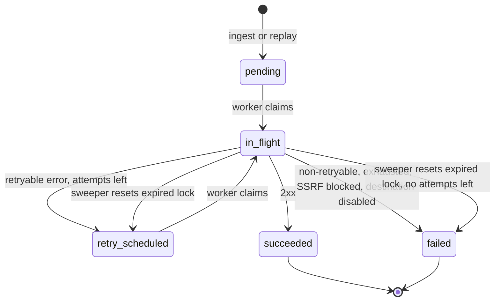

<div align="center">

# RELAY Backend

**A hosted, multi-tenant webhook gateway.**
Store every event byte-exact first. Deliver it later, signed, retried and replayable.

[](https://github.com/parthgupta21/relay-backend/actions/workflows/ci.yml)
[](https://nodejs.org)
[](https://koajs.com)
[](https://www.mysql.com)
[](https://redis.io)
[](https://bullmq.io)
[](https://socket.io)

</div>

---

## Contents

- [Why RELAY](#why-relay)
- [Features](#features)
- [Architecture](#architecture)
- [Tech stack](#tech-stack)
- [Project structure](#project-structure)
- [Quick start](#quick-start)
- [Configuration](#configuration)
- [API reference](#api-reference)
- [Verifying signatures](#verifying-signatures)
- [Reliability](#reliability)
- [Observability](#observability)
- [Security](#security)
- [Deployment](#deployment)
- [Testing](#testing)
- [Known limitations](#known-limitations)
- [Roadmap](#roadmap)
- [Related](#related)
- [License](#license)

## Why RELAY

Webhook senders post once and move on. If your server is down, slow or deploying, the event is at the mercy of the sender's retry policy. Those policies differ, and none of them gives you a way to see what arrived or to replay it safely.

| Sender  | Retry behavior                                                                    | What goes wrong                                                                                  |
| ------- | --------------------------------------------------------------------------------- | ------------------------------------------------------------------------------------------------ |
| Stripe  | Retries for up to 3 days in live mode.                                            | Events can still be missed after the window, and you cannot inspect or replay on your own terms. |
| GitHub  | No automatic retry. Manual redelivery is allowed within 3 days.                   | A deploy gap loses the event unless someone redelivers by hand.                                  |
| Shopify | 5 second timeout, 8 retries over about 4 hours, then the subscription is removed. | A slow handler or a long outage can remove the webhook subscription itself.                      |

RELAY sits in front of your server. Senders post to a stable RELAY URL and get a fast response. RELAY stores the request first, then a separate worker delivers it to your destinations. Your server can be down, slow or redeploying without losing the event.

## Features

**Capture**

- Stable public ingest URL per endpoint: `/h/:slug`, any HTTP method, any sub-path.
- Body stored as raw bytes, byte-exact, so sender signatures still verify downstream.
- Optional per-endpoint idempotency header (for example `x-github-delivery`). Repeats are captured once and answered with `duplicate: true`.
- Per-workspace body size limit, with `413` above it.
- Per-endpoint rate limit and per-workspace daily and monthly event quotas, with `429` and `Retry-After`.

**Delivery**

- A separate worker process delivers each event to every active destination.
- HMAC-SHA256 signed requests with a per-destination signing secret.
- Retries with exponential backoff and equal jitter. `Retry-After` is honoured on `429` and `503`.
- Per-destination and per-workspace concurrency caps.
- Sweeper that recovers stuck and missed deliveries.
- Per-delivery attempt history: outcome, status, duration, error, response headers and body (first 64 KB).

**Replay**

- Replay one delivery or one event to chosen destinations.
- `Idempotency-Key` required on replay. Retried requests return the stored response.
- Hourly replay quota per workspace.

**Usage and analytics**

- Usage metering in Redis: events and delivery attempts per day and per month, with the plan limits next to them (`GET /usage`).
- Delivery analytics over 24 hours or 7 days: success rate, p50 and p95 attempt latency, failure reasons, attempt outcomes and per-destination counts (`GET /analytics/deliveries`).

**Accounts and operations**

- Self-service account deletion. The account is tombstoned at once and the data is purged by the retention job.
- Operator admin API: list workspaces, suspend and reactivate, change plan limits, delete a workspace, read the audit log. Operators see metadata only.
- Prometheus metrics, JSON logs and an access log line on every request.
- Production Docker Compose stack and a deploy workflow.

**Safety**

- SSRF protection on destination URLs, checked on create and again at send time.
- Signing secrets encrypted at rest with AES-256-GCM.
- Per-IP rate limits on the auth routes and on account deletion.
- Retention purge per workspace, plus expired sessions and email tokens.
- Live updates over Socket.IO: `event.created` and `delivery.updated`.
- Tenant isolation: records outside your workspace return `404`.

## Architecture

### How a webhook flows through RELAY


1. Ingest stores the raw event and creates one `pending` delivery per active destination, in one transaction (`routes/ingest.js`).
2. After the commit, each delivery is queued as a BullMQ job. If Redis is down, the sender still gets `200`. The sweeper queues the delivery later.
3. The sender gets `200` with the event id. Delivery happens after this, so a slow destination never slows the sender.
4. The worker takes a concurrency slot for the destination and the workspace. If none is free, the job waits 2 to 5 seconds and tries again (`services/semaphore.js`).
5. The worker marks the delivery `in_flight`, then checks that the destination is still active and that its URL resolves to a public address. Otherwise the delivery fails with `destination_disabled` or `ssrf_blocked`.
6. The request is signed with HMAC-SHA256 (`services/outbound.js`).
7. A 2xx response means `succeeded`. A retryable error schedules another attempt until `maxAttempts` runs out. Any other response fails at once. The attempt and the new status are saved in one transaction (`services/delivery.js`).

Every status change is pushed to the web app as a `delivery.updated` Socket.IO event.

`ROLE=ingest|app|all` (default `all`) chooses what one API process mounts. `ingest` mounts only `/h/*`. `app` mounts only `/api/v1` and Socket.IO. The worker always runs as its own process. The production stack runs one `app`, one `ingest` and one worker.

### Delivery states



Failure reasons stored on `failed`: `non_retryable`, `exhausted`, `ssrf_blocked`, `destination_disabled`.

### Design decisions

| Decision                                                                                                                                           | Why                                                                                                                                                                             | Trade-off                                                                                                                                                 |
| -------------------------------------------------------------------------------------------------------------------------------------------------- | ------------------------------------------------------------------------------------------------------------------------------------------------------------------------------- | --------------------------------------------------------------------------------------------------------------------------------------------------------- |
| Store the event in MySQL before any delivery work. Insert event and deliveries in one transaction.                                                 | The sender gets an answer after a durable write, and nothing depends on Redis being up.                                                                                         | Ingest does a database write per request.                                                                                                                 |
| `addBulk` after commit, with deterministic job IDs `d{id}-a{n}`.                                                                                   | BullMQ drops duplicate job IDs, so ingest, retry, sweeper and replay can all share one enqueue path and re-adding is safe.                                                      | The database row is the source of truth. The queue is only a trigger.                                                                                     |
| Producer Redis connection with `enableOfflineQueue: false`, plus a `status === "ready"` check in ingest.                                           | Without it, `addBulk` waits forever when Redis is down and ingest hangs (verified).                                                                                             | If Redis is down, ingest returns 200 and logs `enqueue skipped`. Deliveries wait for the sweeper, so recovery takes 60 to 90 seconds after Redis returns. |
| Worker claims with a conditional `UPDATE`.                                                                                                         | Two workers cannot run the same attempt.                                                                                                                                        | One extra write per attempt.                                                                                                                              |
| Attempt row and delivery update in one transaction after the HTTP call.                                                                            | The history never disagrees with the delivery status.                                                                                                                           | If the worker dies mid-call, only the sweeper recovers it.                                                                                                |
| Concurrency caps as Redis sorted sets with a Lua script. Key `sem:dst:{id}` and `sem:ws:{id}`, member is the job ID, score is expiry (now + 60 s). | One script prunes expired members and adds to both sets or neither. A crashed worker's slot expires by itself.                                                                  | Slots are not renewed. A refused job is moved to delayed for 2 to 5 seconds with no cap on how often.                                                     |
| Sweeper and retention run on `setInterval` in the worker, not BullMQ repeatable jobs.                                                              | Both are idempotent, so every replica can run them. No scheduler state in Redis.                                                                                                | With N workers, each runs the sweep, which costs more database reads.                                                                                     |
| Idempotency keys in Redis (`idem:{workspaceId}:{key}`, 24 h TTL), reserved with `SET NX`.                                                          | No migration, and TTL expiry is built in.                                                                                                                                       | Keys are not purged by retention. The fingerprint uses the parsed JSON body, so key order matters.                                                        |
| Realtime events go through Redis pub/sub, then Socket.IO.                                                                                          | The worker publishes `delivery.updated` and any API replica forwards it to the right workspace room.                                                                            | Pub/sub is fire-and-forget. A client that is disconnected misses the push.                                                                                |
| SSRF allows only addresses that `ipaddr.js` ranges as `unicast`.                                                                                   | Stricter than a blocklist: tunnel and benchmarking ranges are blocked too. IPv4-mapped IPv6 is converted first.                                                                 | Some unusual but legitimate destination addresses are rejected.                                                                                           |
| Signing secrets encrypted with AES-256-GCM. Stored as iv(12) + tag(16) + ciphertext.                                                               | The worker must read the secret to sign, so it cannot be hashed.                                                                                                                | Losing `RELAY_ENCRYPTION_KEY` makes all secrets unreadable.                                                                                               |
| Sequelize with sequelize-cli, CommonJS, `node:test` and supertest. Layout follows the author's existing service structure.                         | Consistent with the work codebase this project mirrors.                                                                                                                         | Heavier than a query builder.                                                                                                                             |
| Console logging with a `cls-hooked` request context instead of a logging library.                                                                  | Every line carries `requestId`, method and URL without passing context around. Ingest slugs are masked to 6 characters. `LOG_FORMAT=json` switches to one JSON object per line. | The wrapper replaces `console.*` globally and has no log levels or sampling.                                                                              |
| Usage counters, rate limits and quotas in Redis (`usage:{workspaceId}:{kind}:{yyyymmdd}`, `rl:*` keys), all fail open.                             | Counting on the ingest hot path stays one `MULTI` round trip, and no migration is needed. Counters expire after 40 days.                                                        | Counts are not transactional with the event insert, so they can drift by a request. If Redis is down, limits and quotas are not enforced.                 |
| The only way to become an operator is `npm run operator -- grant <email>`. There is no API for it.                                                 | An HTTP route that grants operator rights is a privilege-escalation target. The CLI needs shell access to the deployment.                                                       | Granting needs a shell on a host that can reach the database.                                                                                             |
| Admin routes accept a session only, never a Bearer token.                                                                                          | An API token acts as the workspace owner. It must not carry cross-tenant power.                                                                                                 | Operators cannot script the admin API with a token.                                                                                                       |
| Account deletion tombstones the user and workspace in one transaction. The retention job removes the data later.                                   | The request stays fast and short. Deleting millions of events inside a request would hold locks and time out.                                                                   | Data of a deleted tenant remains until the next retention run.                                                                                            |
| Auth rate limits are keyed by client IP, not by email.                                                                                             | An attacker cannot lock a victim out by sending requests with the victim's email.                                                                                               | Clients behind one NAT share a bucket. Credential stuffing from many IPs is not slowed.                                                                   |
| Metrics are served on a separate, opt-in `METRICS_PORT`, with route templates as labels.                                                           | The public port never exposes `/metrics`, and ingest slugs cannot create unbounded label values.                                                                                | The port must stay private. The server listens on all interfaces inside its container.                                                                    |

## Tech stack

| Layer                  | Choice                                       | Why                                                                                                                                                                                   |
| ---------------------- | -------------------------------------------- | ------------------------------------------------------------------------------------------------------------------------------------------------------------------------------------- |
| Runtime                | Node.js 22 (see `Dockerfile`), CommonJS      | Matches the container image.                                                                                                                                                          |
| HTTP                   | Koa 3 with `@koa/router` 15                  | Small core, async middleware.                                                                                                                                                         |
| Database               | MySQL 8.4 with Sequelize 6 and sequelize-cli | Durable event store and migrations.                                                                                                                                                   |
| Queue and coordination | Redis 7 with BullMQ 6 and ioredis 6          | Delayed jobs for retries, plus semaphores, idempotency keys, quota counters and pub/sub. ioredis is installed explicitly because BullMQ lists it only as an optional peer dependency. |
| Realtime               | Socket.IO 4                                  | Cookie-authenticated pushes to a workspace room.                                                                                                                                      |
| Validation             | zod 4                                        | Request bodies, params and query.                                                                                                                                                     |
| Passwords              | argon2                                       | Memory-hard hashing.                                                                                                                                                                  |
| Raw body               | raw-body 4                                   | Reads the ingest body as bytes.                                                                                                                                                       |
| IP checks              | ipaddr.js                                    | SSRF range classification.                                                                                                                                                            |
| Metrics                | prom-client 15                               | Process, HTTP and delivery metrics on a private port.                                                                                                                                 |
| Email                  | nodemailer, Mailpit locally                  | Verification and reset mail, sent inline.                                                                                                                                             |
| IDs                    | ulid                                         | Prefixed public IDs (`dlv_...`, `ws_...`).                                                                                                                                            |
| Tests                  | `node:test`, supertest, socket.io-client     | Real MySQL, Redis and Mailpit. No mocks of the stores.                                                                                                                                |

## Project structure

```text
.
├── index.js              # Koa app: health, access log, /api/v1, ingest, Socket.IO attach
├── worker.js             # BullMQ worker, sweeper and retention timers, queue gauge
├── logging.js            # console wrapper with request context, text or JSON
├── namespace.js          # cls-hooked namespace
├── config/config.js      # Sequelize CLI config (development, test, production)
├── database/index.js     # Sequelize instance
├── docker/init.sql       # Creates relay and relay_test databases
├── docker-compose.yml    # MySQL, Redis, Mailpit for local development
├── docker-compose.prod.yml # Production stack: mysql, redis, migrate, api, ingest, worker, web
├── Dockerfile            # node:22-slim, runs index.js as USER node
├── .env.example          # Local development settings
├── .env.production.example # Production settings, copied to .env.production
├── deploy/prometheus.yml # Sample scrape config for api, ingest and worker
├── scripts/operator.js   # npm run operator: grant or revoke operator rights
├── .github/workflows/    # ci.yml (test, format, docker), deploy.yml
├── migrations/           # 12 migrations: users to max_events_per_month
├── models/               # user, workspace, session, emailToken, apiToken, endpoint,
│                         # event, destination, delivery, deliveryAttempt, auditLog
├── routes/
│   ├── auth.js           # /api/v1/auth/*
│   ├── tokens.js         # /api/v1/tokens
│   ├── account.js        # /api/v1/account/delete
│   ├── admin.js          # /api/v1/admin/* (operators)
│   ├── analytics.js      # /api/v1/analytics/deliveries
│   ├── usage.js          # /api/v1/usage
│   ├── endpoints.js      # /api/v1/endpoints/*
│   ├── events.js         # events, event body, event replay
│   ├── destinations.js   # destinations and secret rotation
│   ├── deliveries.js     # delivery detail and replay
│   └── ingest.js         # /h/:slug{/*rest}
├── middleware/
│   ├── auth.js           # relay_sid cookie or API token to workspace
│   ├── originCheck.js    # Origin check on POST, PATCH, DELETE
│   ├── requireVerified.js
│   ├── requireOperator.js
│   ├── rateLimit.js      # Per-IP fixed-window limit in Redis, fails open
│   ├── idempotency.js    # Idempotency-Key handling in Redis
│   ├── validate.js       # zod validation
│   └── errorHandler.js   # error envelope, Retry-After
├── services/
│   ├── delivery.js       # processJob: claim, send, classify, retry
│   ├── outbound.js       # signed HTTP send
│   ├── ssrf.js           # address checks, pinned lookup
│   ├── queue.js          # BullMQ queue and producer connection
│   ├── semaphore.js      # Redis concurrency caps
│   ├── sweeper.js        # stuck and missed deliveries
│   ├── replay.js         # delivery and event replay, hourly quota
│   ├── retention.js      # purge expired events, deleted tenants, stale sessions
│   ├── usage.js          # usage counters, ingest rate limit and quotas
│   ├── analytics.js      # delivery analytics queries
│   ├── account.js        # workspace deletion (tombstone)
│   ├── metrics.js        # prom-client registry and the private metrics server
│   ├── realtime.js       # Redis pub/sub and Socket.IO
│   └── email.js
├── utils/                # AppError, IDs, backoff, helpers
└── test/                 # node:test suites, receiver and helpers
```

## Quick start

Prerequisites: Node.js 22, Docker.

```bash
docker compose up -d      # MySQL on 3307, Redis on 6379, Mailpit SMTP 1025, UI http://localhost:8025
cp .env.example .env     # then set RELAY_ENCRYPTION_KEY, see below
npm install
npm run migrate           # dev database "relay"
npm run migrate:test      # test database "relay_test"
```

Run the API and the worker in two terminals. No app containers are used locally. Compose runs only MySQL, Redis and Mailpit.

```bash
npm start                 # API and ingest on :3000 (ROLE=ingest|app|all, default all)
npm run worker            # delivery worker, sweeper, retention
```

Run the tests:

```bash
npm test
```

To use the web app, start [relay-frontend](https://github.com/parthgupta21/relay-frontend). It runs on `http://localhost:5173` and proxies `/api`, `/h` and `/socket.io` to this server. `APP_BASE_URL` in `.env.example` already points at it.

Verification and reset emails appear in Mailpit at `http://localhost:8025`.

To use the admin API, make your verified account an operator once:

```bash
npm run operator -- grant you@example.com
```

For the production stack, see [Deployment](#deployment).

## Configuration

Settings in `.env.example` (development) and `.env.production.example` (production):

| Variable                     | Default in `.env.example`      | Purpose                                                                                                                                                                                   |
| ---------------------------- | ------------------------------ | ----------------------------------------------------------------------------------------------------------------------------------------------------------------------------------------- |
| `NODE_ENV`                   | `development`                  | Environment. `production` makes the session cookie `Secure` and forbids `SSRF_ALLOWLIST`.                                                                                                 |
| `ROLE`                       | `all`                          | `ingest`, `app` or `all`.                                                                                                                                                                 |
| `PORT`                       | `3000`                         | HTTP port.                                                                                                                                                                                |
| `TRUST_PROXY`                | `false`                        | Set `true` behind a trusted proxy so `ctx.ip` uses the last `X-Forwarded-For` entry and `ctx.secure` follows `X-Forwarded-Proto`. Required in production.                                 |
| `APP_BASE_URL`               | `http://localhost:5173`        | Web app origin. Used for the CSRF Origin check, Socket.IO origin check and email links.                                                                                                   |
| `HOOKS_BASE_URL`             | `http://localhost:3000`        | Base URL of the ingest host.                                                                                                                                                              |
| `DB_HOST`, `DB_PORT`         | `127.0.0.1`, `3307`            | MySQL address.                                                                                                                                                                            |
| `DB_NAME`, `DB_NAME_TEST`    | `relay`, `relay_test`          | Dev and test databases.                                                                                                                                                                   |
| `DB_USERNAME`, `DB_PASSWORD` | `relay`, `relay`               | MySQL credentials.                                                                                                                                                                        |
| `SMTP_HOST`, `SMTP_PORT`     | `127.0.0.1`, `1025`            | Mail server. Mailpit locally.                                                                                                                                                             |
| `MAIL_FROM`                  | `RELAY <no-reply@relay.local>` | Sender address.                                                                                                                                                                           |
| `MAILPIT_API`                | `http://localhost:8025/api/v1` | Used by tests to read mail.                                                                                                                                                               |
| `PLAN_DEFAULTS`              | JSON, see below                | Limits given to a new workspace.                                                                                                                                                          |
| `RELAY_ENCRYPTION_KEY`       | none                           | Required. 32-byte base64 key for signing secrets. The API and worker refuse to start without it. Generate: `node -e "console.log(require('crypto').randomBytes(32).toString('base64'))"`. |
| `SSRF_ALLOWLIST`             | `127.0.0.1/32`                 | CIDRs allowed past the SSRF check. Dev and test only. The app throws at load if it is set with `NODE_ENV=production`.                                                                     |
| `REDIS_URL`                  | `redis://127.0.0.1:6379`       | Redis for BullMQ, semaphores, idempotency and pub/sub.                                                                                                                                    |
| `DELIVERY_CONCURRENCY`       | `50`                           | Jobs one worker runs at once.                                                                                                                                                             |

Default `PLAN_DEFAULTS`:

```json
{
  "maxEndpoints": 5,
  "maxDestinations": 3,
  "maxEventsPerDay": 5000,
  "maxEventsPerMonth": 100000,
  "maxBodyBytes": 524288,
  "retentionDays": 3
}
```

Keys you leave out fall back to these values. Operators can change the limits of one workspace later through the [admin API](#admin).

Rate limits, logging and metrics. These are also in `.env.example`:

| Variable                         | Default in `.env.example` | Purpose                                                                                                                      |
| -------------------------------- | ------------------------- | ---------------------------------------------------------------------------------------------------------------------------- |
| `INGEST_RATE_PER_MINUTE`         | `600`                     | Requests per endpoint per minute on `/h/*`. Above it: `429 RATE_LIMITED`.                                                    |
| `AUTH_RATE_PER_MINUTE`           | `10`                      | Requests per client IP per minute on register, login, verify-email, resend-verification, forgot-password and reset-password. |
| `ACCOUNT_DELETE_RATE_PER_MINUTE` | `5`                       | Requests per client IP per minute on `POST /account/delete`.                                                                 |
| `LOG_FORMAT`                     | `text`                    | `json` writes one JSON object per line.                                                                                      |
| `METRICS_PORT`                   | empty                     | Port of the private metrics server. Not started when empty. See [Observability](#observability).                             |

Production-only settings, in `.env.production.example`. They are read at use time and are not in `.env.example`:

| Variable                 | Default | Purpose                                                          |
| ------------------------ | ------- | ---------------------------------------------------------------- |
| `SMTP_USER`, `SMTP_PASS` | not set | SMTP login. Authentication is used only when `SMTP_USER` is set. |
| `SMTP_SECURE`            | `false` | `true` for implicit TLS, usually with port 465.                  |
| `DB_POOL_MAX`            | `10`    | Maximum MySQL connections per process.                           |

Optional knobs. They are read at use time and are not in `.env.example`:

| Variable                  | Default   | Purpose                               |
| ------------------------- | --------- | ------------------------------------- |
| `RETRY_BASE_MS`           | `30000`   | Base delay for backoff.               |
| `RETRY_CAP_MS`            | `3600000` | Maximum retry delay.                  |
| `DESTINATION_CONCURRENCY` | `5`       | In-flight deliveries per destination. |
| `WORKSPACE_CONCURRENCY`   | `20`      | In-flight deliveries per workspace.   |
| `SWEEPER_INTERVAL_MS`     | `30000`   | Sweeper timer.                        |
| `RETENTION_INTERVAL_MS`   | `3600000` | Retention purge timer.                |

The limits are stored on the workspace and returned by `/auth/me`. `maxEndpoints`, `maxDestinations` and `maxBodyBytes` are checked when you create a resource or send a request. `maxEventsPerDay` and `maxEventsPerMonth` are enforced at ingest from the Redis counters. `retentionDays` drives the retention job.

## API reference

Base path: `/api/v1`. Auth is a `relay_sid` session cookie (HttpOnly, SameSite=Lax, 7 days). `POST`, `PATCH` and `DELETE` also require the `Origin` header, when present, to match `APP_BASE_URL`. JSON bodies are limited to 100 KB.

Endpoint, event, destination, delivery, usage and analytics routes also accept an API token as `Authorization: Bearer rly_...`. A token acts as the workspace owner. A request with a Bearer header and no cookie skips the `Origin` check. Token management, `/auth/me`, account deletion and the admin routes accept a session only, and answer `401` to a Bearer token. `POST /auth/logout` needs no authentication: it ends the session named by the cookie. A suspended or deleted workspace gets `403` on every other authenticated route, including `/auth/me`. Sessions are kept while a workspace is suspended, so reactivation restores access.

Auth column: **none** needs no session. **session** needs a logged-in user. **verified** needs a session and a verified email. **operator** needs a session of an operator. **idem** also needs an `Idempotency-Key` header (up to 255 characters).

Rate-limited and quota responses are `429` with a `Retry-After` header in seconds.

Errors use one envelope. `details` appears only when the error carries entries, for example `{ path, message }` pairs on `VALIDATION_FAILED`:

```json
{
  "error": {
    "code": "NOT_FOUND",
    "message": "Delivery not found",
    "requestId": "..."
  }
}
```

| Status | Code                     | When                                                                                                             |
| ------ | ------------------------ | ---------------------------------------------------------------------------------------------------------------- |
| 401    | `UNAUTHENTICATED`        | No or invalid session or API token, or wrong login credentials.                                                  |
| 403    | `FORBIDDEN`              | Origin not allowed, workspace not active, the route needs an operator, or an operator deletes their own account. |
| 403    | `EMAIL_NOT_VERIFIED`     | The route needs a verified email.                                                                                |
| 404    | `NOT_FOUND`              | Unknown route, or a record outside your workspace. Also unknown or disabled ingest slugs.                        |
| 409    | `CONFLICT`               | A request with the same `Idempotency-Key` is in progress, or an admin action hits a bad state.                   |
| 413    | `PAYLOAD_TOO_LARGE`      | Ingest body above the workspace limit.                                                                           |
| 422    | `VALIDATION_FAILED`      | Invalid input. `details` lists `{ path, message }` entries.                                                      |
| 422    | `IDEMPOTENCY_KEY_REUSED` | The key was already used with a different request.                                                               |
| 422    | `QUOTA_EXCEEDED`         | Endpoint, destination or API token cap reached.                                                                  |
| 429    | `RATE_LIMITED`           | Ingest, auth, account delete or replay rate limit. Carries `Retry-After`.                                        |
| 429    | `QUOTA_EXCEEDED`         | Daily or monthly event quota reached at ingest. Carries `Retry-After`.                                           |
| 500    | `INTERNAL`               | Unexpected error. Details are in the logs under the request ID.                                                  |
| 503    | `SERVICE_UNAVAILABLE`    | Database or Redis unavailable where the route needs it: `/readyz`, `/usage`, and replay (Idempotency-Key store). |

### Auth

| Method | Path                        | Auth    | Purpose                                                                                                                    |
| ------ | --------------------------- | ------- | -------------------------------------------------------------------------------------------------------------------------- |
| POST   | `/auth/register`            | none    | Create an account. Always answers `202`, whether or not the email exists. Rejects `@deleted.invalid` addresses with `422`. |
| POST   | `/auth/verify-email`        | none    | Consume a verification token.                                                                                              |
| POST   | `/auth/resend-verification` | none    | Send a new verification email. Answers `202`.                                                                              |
| POST   | `/auth/login`               | none    | Start a session and set the cookie.                                                                                        |
| POST   | `/auth/logout`              | none    | End the session named by the cookie. Works for suspended users.                                                            |
| POST   | `/auth/forgot-password`     | none    | Send a reset email. Answers `202`.                                                                                         |
| POST   | `/auth/reset-password`      | none    | Set a new password with a reset token.                                                                                     |
| GET    | `/auth/me`                  | session | Current user (including `isOperator`), workspace status and plan limits.                                                   |

Register, verify-email, resend-verification, login, forgot-password and reset-password share one per-IP limit: `AUTH_RATE_PER_MINUTE` requests per minute (default 10), then `429 RATE_LIMITED`. Logout and `/auth/me` are not limited.

### Endpoints

| Method | Path                         | Auth     | Purpose                                                   |
| ------ | ---------------------------- | -------- | --------------------------------------------------------- |
| GET    | `/endpoints`                 | session  | List endpoints.                                           |
| POST   | `/endpoints`                 | verified | Create an endpoint. Checks `maxEndpoints`.                |
| GET    | `/endpoints/:id`             | session  | Get one endpoint.                                         |
| PATCH  | `/endpoints/:id`             | session  | Rename, change the idempotency header, enable or disable. |
| DELETE | `/endpoints/:id`             | session  | Delete an endpoint.                                       |
| POST   | `/endpoints/:id/rotate-slug` | session  | Issue a new ingest slug.                                  |

### Events

| Method | Path                    | Auth           | Purpose                                                                                                                                                                |
| ------ | ----------------------- | -------------- | ---------------------------------------------------------------------------------------------------------------------------------------------------------------------- |
| GET    | `/endpoints/:id/events` | session        | List events. Query: `limit`, `cursor`, `method`. Cursor is opaque.                                                                                                     |
| GET    | `/events/:id`           | session        | Event detail with its deliveries.                                                                                                                                      |
| GET    | `/events/:id/body`      | session        | Download the raw body as an attachment.                                                                                                                                |
| POST   | `/events/:id/replay`    | verified, idem | Replay to the listed `destinationIds`, or to every active destination of the endpoint when omitted. `202` with `deliveries`. `429 RATE_LIMITED` over the hourly quota. |

### Destinations

| Method | Path                              | Auth     | Purpose                                                                          |
| ------ | --------------------------------- | -------- | -------------------------------------------------------------------------------- |
| GET    | `/endpoints/:id/destinations`     | session  | List destinations.                                                               |
| POST   | `/endpoints/:id/destinations`     | verified | Create a destination. Returns the signing secret once. Checks `maxDestinations`. |
| PATCH  | `/destinations/:id`               | session  | Update name, URL, timeout, headers or active flag.                               |
| DELETE | `/destinations/:id`               | session  | Soft delete.                                                                     |
| POST   | `/destinations/:id/rotate-secret` | session  | Issue a new signing secret. Returned once.                                       |

### Deliveries

| Method | Path                     | Auth           | Purpose                                                                               |
| ------ | ------------------------ | -------------- | ------------------------------------------------------------------------------------- |
| GET    | `/deliveries/:id`        | session        | Delivery with its attempt history.                                                    |
| POST   | `/deliveries/:id/replay` | verified, idem | Replay one delivery. `202` with `delivery`. `429 RATE_LIMITED` over the hourly quota. |

### API tokens

| Method | Path          | Auth     | Purpose                                                                                                       |
| ------ | ------------- | -------- | ------------------------------------------------------------------------------------------------------------- |
| GET    | `/tokens`     | session  | List tokens (name, prefix, expiry, last used). The secret is never returned again.                            |
| POST   | `/tokens`     | verified | Create a token. Body: `name`, optional `expiresInDays` (1 to 365). Returns it once. At most 20 per workspace. |
| DELETE | `/tokens/:id` | session  | Revoke (hard delete).                                                                                         |

### Usage

| Method | Path     | Auth                 | Purpose                                                                        |
| ------ | -------- | -------------------- | ------------------------------------------------------------------------------ |
| GET    | `/usage` | session or API token | Usage counters and plan limits for the workspace. `503` if Redis is not ready. |

The response has four keys. All dates are UTC.

| Key         | Content                                                                                       |
| ----------- | --------------------------------------------------------------------------------------------- |
| `month`     | `start`, `resetsAt`, `events`, `eventsLimit` and `deliveries` for the current calendar month. |
| `today`     | `date`, `events`, `deliveries` and `eventsLimit` for the current day.                         |
| `rateLimit` | `perEndpointPerMinute`, the value of `INGEST_RATE_PER_MINUTE`.                                |
| `days`      | The last 31 days, oldest first, each with `date`, `events` and `deliveries`.                  |

`events` counts captured events. Duplicates answered with `duplicate: true` and rejected requests are not counted. `deliveries` counts recorded delivery attempts, so each retry counts. Counters live in Redis and expire after 40 days.

At ingest, a request over the limits is answered before the body is read, in this order:

| Check               | Response                                                                       |
| ------------------- | ------------------------------------------------------------------------------ |
| Endpoint rate limit | `429 RATE_LIMITED`. `Retry-After` is the seconds left in the current minute.   |
| `maxEventsPerMonth` | `429 QUOTA_EXCEEDED`. `Retry-After` is the seconds until the next month (UTC). |
| `maxEventsPerDay`   | `429 QUOTA_EXCEEDED`. `Retry-After` is the seconds until the next day (UTC).   |

The rate limit is a fixed one-minute window per endpoint. Rejected requests still count toward it. If Redis is not ready, the checks are skipped and the event is captured.

### Analytics

| Method | Path                    | Auth                 | Purpose                                                                                |
| ------ | ----------------------- | -------------------- | -------------------------------------------------------------------------------------- |
| GET    | `/analytics/deliveries` | session or API token | Delivery statistics. Query: `range` (`24h` default, or `7d`), `endpointId` (optional). |

An unknown `endpointId` returns `404`. Deliveries are counted by creation time, so a replay counts in the bucket where it was created. The response has these keys:

| Key               | Content                                                                                                                                        |
| ----------------- | ---------------------------------------------------------------------------------------------------------------------------------------------- |
| `range`, `bucket` | The range asked for and its bucket size: `hour` for `24h` (24 buckets), `day` for `7d` (7 buckets).                                            |
| `from`, `to`      | The window. Buckets are aligned to UTC hours or days, and the last bucket is the current, partial one.                                         |
| `retentionDays`   | The workspace retention. Deliveries older than this are purged, so older buckets are empty.                                                    |
| `totals`          | `deliveries`, `succeeded`, `failed`, `inProgress`, `successRate`, `attempts`, `p50Ms`, `p95Ms`.                                                |
| `series`          | One entry per bucket: `start`, `succeeded`, `failed`, `inProgress`.                                                                            |
| `failureReasons`  | Counts of `non_retryable`, `exhausted`, `ssrf_blocked` and `destination_disabled`.                                                             |
| `outcomes`        | Attempt counts: `success`, `http_error`, `timeout`, `network_error`, `blocked`.                                                                |
| `destinations`    | Up to 10 destinations by delivery count: `id`, `name`, `deleted`, `deliveries`, `succeeded`, `failed`. Soft-deleted destinations are included. |

`successRate` is `succeeded / (succeeded + failed)` as a fraction, and `null` when nothing has finished. `inProgress` covers `pending`, `in_flight` and `retry_scheduled`. `p50Ms` and `p95Ms` are attempt durations in milliseconds (nearest rank), excluding `blocked` attempts, and `null` when there are no attempts.

### Account

| Method | Path              | Auth    | Purpose                                                                          |
| ------ | ----------------- | ------- | -------------------------------------------------------------------------------- |
| POST   | `/account/delete` | session | Delete your account and workspace. Body: `{ "password": "..." }`. Answers `204`. |

- Session only. A Bearer token gets `401`. A suspended workspace gets `403` before the password is checked.
- Operators get `403`. Revoke the operator role with the CLI first.
- A wrong password is `422 VALIDATION_FAILED` and writes the audit row `account.delete_failed`.
- Per-IP limit: `ACCOUNT_DELETE_RATE_PER_MINUTE` (default 5), then `429 RATE_LIMITED`.

On success, one transaction:

- Rewrites the email to `deleted-<publicId>@deleted.invalid`, sets the password hash to `!` and sets `deleted_at` on the user.
- Sets the workspace status to `deleted`.
- Destroys the user's sessions and email tokens and the workspace's API tokens.
- Writes the audit row `account.deleted`.

After the commit, the usage and idempotency keys of the workspace are unlinked from Redis. A failure there is logged and does not undo the deletion. The next retention run deletes the endpoints and events of the deleted workspace, whatever their age. Deliveries and attempts follow through `ON DELETE CASCADE`. The same email can register again. Addresses ending in `@deleted.invalid` cannot register.

### Admin

Operators only: a session whose user has `isOperator`. A non-operator gets `403` and a Bearer token gets `401`. Operators see metadata only: never event payloads, headers, destination URLs or secrets.

An operator is created with the CLI, because no API route grants the role:

```bash
npm run operator -- grant you@example.com
npm run operator -- revoke you@example.com
```

`grant` needs an existing, verified, non-deleted user. Both commands write the audit row `operator.granted` or `operator.revoked` and exit with code 1 on failure. In the production stack, run it in the `api` container (see [Deployment](#deployment)).

| Method | Path                           | Auth     | Purpose                                                                                                             |
| ------ | ------------------------------ | -------- | ------------------------------------------------------------------------------------------------------------------- |
| GET    | `/admin/workspaces`            | operator | List workspaces, newest first. Query: `q` (owner email prefix), `status`, `limit` (1 to 100, default 50), `cursor`. |
| GET    | `/admin/workspaces/:id`        | operator | Workspace detail: owner, limits, counts, usage and the last 20 audit rows.                                          |
| PATCH  | `/admin/workspaces/:id`        | operator | Change `status` (`active` or `suspended`) and `limits`. At least one key. Unknown keys are `422`.                   |
| POST   | `/admin/workspaces/:id/delete` | operator | Delete a workspace like account deletion. Body: `{ "confirm": "<exact owner email>" }`. Answers `204`.              |
| GET    | `/admin/audit`                 | operator | Audit log, newest first. Query: `workspaceId`, `action`, `limit`, `cursor`.                                         |

List items have `id`, `status`, `ownerEmail`, `ownerVerified`, `ownerIsOperator`, `endpointCount` and `createdAt`, plus `nextCursor`. Audit items have `action`, `workspaceId`, `actorEmail`, `ip`, `meta` and `createdAt`. Cursors are opaque.

`PATCH` rules:

- `limits` accepts these keys, each an integer in the range shown: `maxEndpoints` 1 to 1 000, `maxDestinations` 1 to 100, `maxEventsPerDay` 1 to 10 000 000, `maxEventsPerMonth` 1 to 100 000 000, `maxBodyBytes` 1 024 to 10 485 760, `retentionDays` 1 to 90.
- Each change writes an audit row: `admin.workspace.suspended`, `admin.workspace.reactivated` or `admin.workspace.limits_updated` (only changed keys, with before and after). A value equal to the current one writes nothing.
- `409 CONFLICT` if the workspace is deleted, or if an operator changes the status of their own workspace.
- Suspending takes effect at once. See [Suspension](#suspension).

`POST /admin/workspaces/:id/delete` answers `409` for a deleted workspace or one owned by an operator, and `422` if `confirm` does not equal the owner email exactly. It writes `admin.workspace.deleted`. The workspace row is locked, so of two concurrent deletes one succeeds and the other gets `409`. `GET /admin/audit` with an unknown `workspaceId` is `404`.

Audit actions written by the application: `login`, `login.failed`, `password.reset`, `token.created`, `token.revoked`, `account.deleted`, `account.delete_failed`, `admin.workspace.suspended`, `admin.workspace.reactivated`, `admin.workspace.limits_updated`, `admin.workspace.deleted`, `operator.granted`, `operator.revoked`.

#### Suspension

A suspended workspace:

- Gets `403` on every authenticated route, for sessions and API tokens. `POST /auth/logout` still works.
- Gets `404` from ingest. Events sent to its endpoints are not captured.
- Fails queued deliveries as `destination_disabled` when the worker picks them up. They are not paused.
- Cannot open new Socket.IO connections. Connections that are already open stay connected until they reconnect.
- Keeps its sessions, so reactivation restores access. Login itself still succeeds and returns `workspace.status`.

### Ingest and health

| Method | Path                        | Auth | Purpose                                                                                                                                                                    |
| ------ | --------------------------- | ---- | -------------------------------------------------------------------------------------------------------------------------------------------------------------------------- |
| ANY    | `/h/:slug` and `/h/:slug/*` | none | Capture a request. Returns `200 { id, duplicate }`. `404` for unknown or disabled slugs or a workspace that is not active, `413` above the body limit, `429` over a limit. |
| GET    | `/healthz`                  | none | Liveness.                                                                                                                                                                  |
| GET    | `/readyz`                   | none | Readiness. Answers `503` if MySQL is down. The body `{ ok, redis }` reports Redis, but Redis does not affect the status code.                                              |

### Realtime

Socket.IO on `/socket.io`. The handshake must carry the `relay_sid` cookie and an allowed origin. A workspace that is not active is refused at the handshake. Each socket joins its workspace room.

| Event              | Payload                           |
| ------------------ | --------------------------------- |
| `event.created`    | `{ endpointId, eventId }`         |
| `delivery.updated` | `{ deliveryId, eventId, status }` |

Only the worker publishes `delivery.updated`, when it claims a delivery and when it settles one. Creating a replay delivery and the sweeper's resets are not pushed, so clients should keep polling as a fallback.

## Verifying signatures

Every delivery carries these headers, set in `services/outbound.js`:

| Header                | Value                                   |
| --------------------- | --------------------------------------- |
| `X-Relay-Signature`   | `t=<unix seconds>,v1=<hex HMAC-SHA256>` |
| `X-Relay-Timestamp`   | Unix seconds, same as `t`.              |
| `X-Relay-Event-Id`    | Event public ID.                        |
| `X-Relay-Delivery-Id` | Delivery public ID.                     |
| `X-Relay-Attempt`     | Attempt number.                         |

The signed string is the timestamp, a dot, then the raw request body bytes. The key is the destination's signing secret (`whsec_...`).

```js
const crypto = require("crypto");

// rawBody must be the unparsed request body (Buffer), not re-serialized JSON.
function verify(rawBody, signatureHeader, secret, toleranceSeconds = 300) {
  const parts = Object.fromEntries(
    signatureHeader.split(",").map((part) => part.split("=")),
  );
  const t = parts.t;
  const expected = crypto
    .createHmac("sha256", secret)
    .update(`${t}.`)
    .update(rawBody)
    .digest("hex");

  const a = Buffer.from(expected);
  const b = Buffer.from(parts.v1 || "");
  if (a.length !== b.length || !crypto.timingSafeEqual(a, b)) return false;

  // Recommended: reject old timestamps to limit replay of captured requests.
  return Math.abs(Date.now() / 1000 - Number(t)) <= toleranceSeconds;
}
```

The timestamp check is a recommendation. RELAY does not enforce a tolerance on your side.

## Reliability

Retry rules, from `services/delivery.js` and `utils/backoff.js`:

| Outcome                                     | Result                                                          |
| ------------------------------------------- | --------------------------------------------------------------- |
| `2xx`                                       | `succeeded`.                                                    |
| `408`, `429`, `5xx`, timeout, network error | Retryable.                                                      |
| `3xx`, other `4xx`, SSRF blocked            | Not retryable. `failed` with `non_retryable` or `ssrf_blocked`. |
| Attempts used up                            | `failed` with `exhausted`.                                      |

- Default `maxAttempts` per destination is 8. Default request timeout is 10 000 ms. Connect timeout is 5 000 ms.
- Delay before attempt `n` is `min(cap, base * 2^(n-2))` with equal jitter: half fixed, half random. Defaults are 30 s base and 1 h cap.
- `Retry-After` (seconds or HTTP date) on `429` and `503` wins when it is longer, still capped.
- A retry is a delayed BullMQ job `d{id}-a{n+1}`, added after the database commit.
- Response bodies are read up to 64 KB, then the socket is destroyed.
- Redirects are not followed. `3xx` is treated as non-retryable.
- The sweeper runs every 30 s and walks every due delivery in batches of 500:
  - `pending` or `retry_scheduled` with `next_attempt_at` older than 60 s are enqueued again.
  - `in_flight` with `locked_until` in the past becomes `retry_scheduled` (the crashed attempt counts) or `failed` with `exhausted`.
  - The reset is a conditional `UPDATE`, so a delivery that finished in the meantime is untouched.
- Retention runs every `RETENTION_INTERVAL_MS` (default one hour), in the worker. It does three things:
  - Per workspace, events older than `retentionDays` are deleted in batches of 1 000. Deliveries and attempts follow through `ON DELETE CASCADE`.
  - For a workspace with status `deleted`, all events are deleted regardless of age, then its endpoints.
  - Expired sessions and used or expired email tokens are deleted. These two deletes are single statements, not batched.
- Replay quota is 100 requests per workspace per UTC hour. Over it, the answer is `429 RATE_LIMITED` with `Retry-After` set to the seconds until the next hour. One event replay to several destinations costs one.
- The worker closes its queue, timers and database on `SIGTERM` and `SIGINT`. The API process does the same on `SIGTERM` and forces exit after 10 seconds.

Other known gaps are tracked in [`memory.md`](memory.md). See also [Known limitations](#known-limitations).

## Observability

**Metrics.** Set `METRICS_PORT` to start a second, private HTTP server in the API, ingest and worker processes. It is off when the variable is empty. It serves:

| Path       | Answer                                                                                                             |
| ---------- | ------------------------------------------------------------------------------------------------------------------ |
| `/metrics` | Prometheus text format.                                                                                            |
| `/healthz` | `200` while the process runs.                                                                                      |
| `/readyz`  | `200` if MySQL answers, `503` otherwise. In the worker, the BullMQ worker must also be running. The body is empty. |

The server listens on all interfaces inside its container. Never publish this port. The sample [`deploy/prometheus.yml`](deploy/prometheus.yml) scrapes `api:9100`, `ingest:9100` and `worker:9100` on the Compose network.

All metrics use the `relay_` prefix, and the default Node.js process metrics are included.

| Metric                                    | Type      | Labels                      | Process        |
| ----------------------------------------- | --------- | --------------------------- | -------------- |
| `relay_http_requests_total`               | counter   | `method`, `route`, `status` | API and ingest |
| `relay_http_request_duration_seconds`     | histogram | `method`, `route`           | API and ingest |
| `relay_delivery_attempts_total`           | counter   | `outcome`                   | worker         |
| `relay_delivery_attempt_duration_seconds` | histogram | none                        | worker         |
| `relay_queue_jobs`                        | gauge     | `state`                     | worker         |

The `route` label is the router template, for example `/h/:slug{/*rest}` or `/api/v1/events/:id`, or `unmatched`. Slugs and record IDs never appear as label values. `relay_queue_jobs` reports `waiting`, `delayed` and `active` jobs of the delivery queue.

**Logs.** `LOG_FORMAT=json` writes one object per line with `ts`, `level`, `requestId`, `method`, `url` and `msg`. The default text format is `level=[INFO] requestId=... method=... url=... msg="..."`. Ingest slugs are masked to 6 characters in `url`, and `url` never includes the query string.

**Access log.** Every request on the main port writes one line, `request status=<code> durationMs=<ms>`, with the request ID, method and path. Health checks (`/healthz`, `/readyz`) are skipped. The line has no bodies, no `Authorization` or `Cookie` headers, no query strings and no full slugs.

**Health.** `/healthz` on the main port is liveness. `/readyz` answers `503` only when MySQL is down. Its body also shows `redis`, which is informational.

## Security

- **Sessions.** Random token in an HttpOnly, SameSite=Lax cookie (`Secure` in production), 7 day lifetime.
- **Passwords.** argon2, minimum 10 characters. Register and resend answer the same way whether or not an account exists.
- **CSRF.** `POST`, `PATCH` and `DELETE` on `/api/v1` are rejected with `403` if `Origin` is present and not `APP_BASE_URL`. Socket.IO applies the same origin check.
- **Tenant isolation.** Reads go through workspace-scoped queries. A record you do not own returns `404`, never `403`.
- **SSRF.** Destination URLs are checked on create. The worker re-resolves and checks again, then connects to the pinned address so DNS cannot change between check and send. Only `unicast` ranges pass, `::/96` is blocked, and a destination cannot point at the RELAY ingest host. `SSRF_ALLOWLIST` is refused in production.
- **Signing secrets.** Generated as `whsec_` plus 32 random bytes. Encrypted with AES-256-GCM. Returned only by create and rotate.
- **Forwarded headers.** Hop-by-hop headers, `host`, `content-length`, `cookie`, `authorization` and `proxy-*` are dropped before forwarding. Tenants add auth through destination `customHeaders`, which reject invalid names and the hop-by-hop, `host` and `content-length` headers.
- **Stored headers.** `authorization`, `proxy-authorization` and `cookie` are stored as `[redacted]`. Events stored before this change keep their values until retention deletes them.
- **Auth rate limits.** Register, login, verify-email, resend-verification, forgot-password and reset-password allow `AUTH_RATE_PER_MINUTE` requests (default 10) per client IP per minute, and account deletion allows `ACCOUNT_DELETE_RATE_PER_MINUTE` (default 5). The window is fixed (one UTC minute) and held in Redis. Above the limit the answer is `429 RATE_LIMITED` with `Retry-After`. The limit is per IP, not per email, so an attacker cannot lock a victim out. If Redis is not ready or a command fails, the request goes through (fail open).
- **Client IP.** With `TRUST_PROXY=true`, the client IP is the last `X-Forwarded-For` entry, so a client cannot spoof it by adding earlier entries. The bundled nginx overwrites the header with the address of its direct peer. See [Deployment](#deployment).
- **Account deletion.** Needs the password, the session and a non-operator account. The tombstoned account cannot log in, and its email can be registered again.
- **Operators.** Created only by the CLI. Admin routes accept a session only. Operators see metadata only: never payloads, headers, destination URLs or secrets. Every admin change is audited.
- **Errors.** Unexpected errors become a generic `500 INTERNAL`. Details stay in the logs with the request ID.
- **Logs.** Ingest slugs are masked to the first 6 characters. The access log has no bodies, auth or cookie headers, or query strings.
- **Metrics.** Served on a private port only. Labels are router templates, never slugs.
- **Container.** The image runs as the non-root `node` user.

To report a vulnerability, see [SECURITY.md](SECURITY.md).

## Deployment

`docker-compose.prod.yml` runs the full stack on one Docker host.

| Service   | Image or command                                     | Role                                                          |
| --------- | ---------------------------------------------------- | ------------------------------------------------------------- |
| `mysql`   | `mysql:8.4`, volume `mysql_data`                     | Database.                                                     |
| `redis`   | `redis:7`, AOF on, `noeviction`, volume `redis_data` | Queue, counters, idempotency keys and pub/sub.                |
| `migrate` | backend image, `npm run migrate`                     | One-shot. The API services wait for it to finish.             |
| `api`     | backend image, `ROLE=app`                            | `/api/v1` and Socket.IO. One replica only.                    |
| `ingest`  | backend image, `ROLE=ingest`                         | `/h/*` only.                                                  |
| `worker`  | backend image, `node worker.js`                      | Delivery worker, sweeper and retention.                       |
| `web`     | frontend image (nginx)                               | Serves the web app and proxies `/api`, `/h` and `/socket.io`. |

Only `web` publishes a port: `${WEB_PORT:-8080}` on the host to port 80. MySQL, Redis, the API, the ingest service and the metrics ports stay on the Compose network. Every service except `migrate` has a healthcheck. `api` and `ingest` poll `/readyz` on port 3000, the worker polls `/readyz` on port 9100, and `web` waits for `api` and `ingest` to be healthy.

### Set up

```bash
cp .env.production.example .env.production   # then set the values below
docker compose -f docker-compose.prod.yml --env-file .env.production pull
docker compose -f docker-compose.prod.yml --env-file .env.production up -d
```

Set at least `DB_PASSWORD`, `RELAY_ENCRYPTION_KEY`, `APP_BASE_URL`, `HOOKS_BASE_URL` and the `SMTP_*` values. Keep `PORT=3000` and `METRICS_PORT=9100`, because the healthchecks use them. Do not set `SSRF_ALLOWLIST`: the app refuses to start with it in production.

Pass `--env-file .env.production` on every `docker compose` command, including `run` and `exec`. The services read the file through `env_file`, but Compose fills the `${...}` placeholders only from `--env-file`. The `mysql` service gets nothing except `DB_NAME`, `DB_USERNAME` and `DB_PASSWORD` this way, plus a random root password, so the encryption key and SMTP credentials never enter the database container.

The images default to `ghcr.io/parthgupta21/relay-backend:latest` (`RELAY_IMAGE`) and `ghcr.io/parthgupta21/relay-frontend:latest` (`RELAY_WEB_IMAGE`). If you do not pull them, Compose builds them from this directory and from `RELAY_FRONTEND_DIR` (default `../relay-frontend`). The ghcr packages must be public, or the server must run `docker login ghcr.io` first.

### First operator

Register in the web app and verify the email, then:

```bash
docker compose -f docker-compose.prod.yml --env-file .env.production run --rm api npm run operator -- grant you@example.com
```

### TLS and client IPs

The stack serves plain HTTP. TLS must terminate in front of it, for example at a load balancer, and the balancer must send `X-Forwarded-Proto: https`. The session cookie is `Secure` in production. If the request reaches the app as plain HTTP, setting the cookie fails and login returns `500`. The bundled nginx passes `https` on only when the balancer sends it.

`TRUST_PROXY=true` is required, because the app reads the client IP from `X-Forwarded-For`. The bundled nginx overwrites that header with the address of its direct peer, so a client cannot inject one. If a load balancer sits between the client and nginx, the direct peer is the balancer. The per-IP rate limits, the audit log and the stored source IP of events then show the balancer's address. The nginx template has no `real_ip` configuration.

### Backups

- MySQL: `mysqldump` of the `relay` database, or a snapshot of the `mysql_data` volume.
- Redis: the AOF file in the `redis_data` volume. It holds queued jobs, idempotency keys and usage counters.

### CI and deploy

`.github/workflows/ci.yml` runs three jobs: `test` (migrations and the test suite against MySQL, Redis and Mailpit), `format` (`prettier --check .`) and `docker` (builds the image and runs `docker compose config -q` on the production file).

`.github/workflows/deploy.yml` runs on `workflow_dispatch` and on tags that match `v*`. A `gate` job skips everything unless the secrets `DEPLOY_HOST`, `DEPLOY_USER` and `DEPLOY_SSH_KEY` exist. Otherwise it pushes the backend image to ghcr tagged with the commit SHA and `latest`, then connects over SSH to `$DEPLOY_PATH` (repository variable, default `relay`) and runs `pull`, `run --rm migrate` and `up -d`. The workflow does not copy files. The server needs a clone of this repository at that path, with `.env.production` in it. The web image is built and pushed by the workflow in relay-frontend, and `pull` fetches both.

## Testing

```bash
npm test
```

This migrates `relay_test`, then runs `node --test --test-concurrency=1 "test/*.test.js"` serially. Tests need MySQL, Redis and Mailpit from `docker compose up -d`. They use the queue `deliveries-test`, `test:`-prefixed Redis keys and a separate Redis channel, so a running dev worker never picks up test jobs.

The suite has 221 tests in 28 files under `test/`. It covers auth, endpoints, ingest, ingest limits and safety, destinations, forwarding, the delivery engine, backoff, SSRF, semaphores, sweeper, replay, retention, pagination, tenant isolation, realtime, API tokens, Bearer auth, usage and quotas, analytics, account deletion, the operator and admin API, rate limits, proxy handling and metrics.

See [CONTRIBUTING.md](CONTRIBUTING.md) for the workflow. CI is defined in `.github/workflows/ci.yml`.

## Known limitations

Findings from the production-stack smoke test, plus the open items in [`memory.md`](memory.md).

- **Plain-HTTP login fails in production.** With `NODE_ENV=production` the session cookie is `Secure`. If the request reaches the app as plain HTTP, setting the cookie throws and `POST /auth/login` returns `500`. Serve the stack over HTTPS, or terminate TLS in front of it and send `X-Forwarded-Proto: https`. See [TLS and client IPs](#tls-and-client-ips).
- **NAT64 destinations are blocked.** The SSRF guard accepts only `unicast` addresses, so a destination in `64:ff9b::/96` is rejected.
- **Raw route label on `/admin` 403 responses.** A `403` on an `/admin` route can appear in `relay_http_requests_total` with a raw route-regex string as the `route` label instead of a template.
- **nginx error log can contain an ingest slug.** On upstream errors, nginx's own error log may include the request path. The access log format is masked, the error log is not.
- **CORS preflight requests are captured.** Ingest sends no CORS headers, so a browser `OPTIONS` preflight sent to an ingest URL is stored as an event and counts toward the endpoint's rate limit and the workspace's daily and monthly quota.

## Roadmap

- [x] **Phase 1.** Foundation, auth, endpoints, ingest, inspector API.
- [x] **Phase 2.** Destinations, deliveries, SSRF checks, encrypted secrets, BullMQ queue, worker, outbound HTTP.
- [x] **Phase 3.** Retries with backoff and jitter, concurrency semaphores, sweeper, manual replay with `Idempotency-Key`, retention purge.
- [x] **Phase 4.** Realtime and limits.
  - [x] Socket.IO live updates (`event.created`, `delivery.updated`), polling kept as fallback.
  - [x] API tokens.
  - [x] Usage metering, per-endpoint rate limits and daily and monthly quotas.
- [x] **Phase 5.** Analytics, account deletion, admin.
  - [x] Delivery analytics.
  - [x] Account deletion with tombstone and later purge.
  - [x] Operator admin API with an audit log. The matching screens are in relay-frontend.
- [x] **Phase 6.** Hardening, deploy, observability.
  - [x] Per-IP rate limits on the auth routes and account deletion, and purge of expired sessions and email tokens.
  - [x] Prometheus metrics on a private port, JSON logs and an access log.
  - [x] Production Docker Compose stack, the nginx web image with a strict CSP, and the GHCR deploy workflow.

## Related

- [relay-frontend](https://github.com/parthgupta21/relay-frontend): React web app for endpoints, the live inspector, deliveries and replay.

## License

No open-source license is granted. The package is marked `UNLICENSED`.

Copyright (c) 2026 Parth Gupta. All rights reserved.
